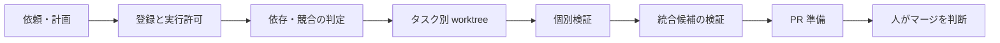

# Counterpointer (CPT)

Counterpointer は、Codex に複数の実装タスクを任せるためのローカル CLI です。

個人開発として、自分の開発フローに組み込んで改善しています。現在は macOS、zsh、cmux、Codex CLI を前提にしています。

## 何を改善するためのものか

複数のタスクを AI エージェントに同時に任せると、依頼の内容を固める、作業場所を分ける、変更の衝突を見つける、完了した成果をまとめて確かめる、といった管理が必要になります。ここを手作業で続けると、タスクごとの進捗や「何を確認してから公開するか」が分かりにくくなります。

CPT では、依頼を計画として記録してから実行を許可し、タスクごとに Git worktree と子 Codex を割り当てます。依存関係と変更対象を見て並列に進め、個別の成果だけでなく、統合した状態でも検証します。GitHub への PR 作成まで扱えますが、main へのマージは人が判断します。

複数の実装を同時に任せても、どの依頼からどんな変更が生まれ、統合後に動くかまで追えるようにしたくて作っています。

## 設計で重視したこと

1. **依頼と実行を分ける**：曖昧な依頼は確認し、詳細な依頼は合意した計画のハッシュを固定します。登録だけでは実行せず、明示的に許可されたタスクを開始します。
2. **並列作業を分離する**：各タスクを専用 worktree で進め、対象パスと依存関係を使って競合する作業を直列化します。
3. **統合した状態で確かめる**：個別タスクの検証に加え、変更をまとめた候補に対して検証を行います。競合や検証失敗では公開を止めます。
4. **外部操作に境界を置く**：ローカルの権限外操作には承認が必要です。PR 作成までの自動化を設定できますが、main の自動マージや force push は行いません。



状態と監査記録は SQLite に保存します。CLI の実装は `bin/cpt`、振る舞いの確認は `tests/` にあります。

## 動作環境

- macOS、zsh、Git、SQLite CLI、jq、OpenSSL
- Codex CLI と cmux（エージェントの起動・表示に使用）
- GitHub CLI `gh`（GitHub への PR 作成を使う場合）

動作確認は macOS を中心に行っています。他の OS での動作は確認していません。

## まず試す

リポジトリを取得します。

```sh
git clone https://github.com/lilkaye1007/counterpointer-public.git
cd counterpointer-public
```

まず CLI と基本テストを確認できます。テストは一時的な Git リポジトリを作成し、実際の GitHub には接続しません。

```sh
./bin/cpt version --json
zsh tests/smoke.zsh
```

全テストは `./bin/cpt test all` で実行できます。

## 自分のリポジトリで使う

`bin/install --dry-run` でインストール先を確認してからインストールします。既定のインストール先は `~/.local/bin/cpt` です。ここに PATH が通っていない場合は追加してください。エージェントを起動するには cmux と Codex CLI の設定が必要です。

```sh
bin/install --dry-run
bin/install
cd /path/to/your/git-repository
cpt init
cpt service install
cpt service configure-credentials --profile phase1-attended
cpt start
```

`cpt init` は Git 管理中のファイルから索引の**候補**を作ります。この時点では索引を確定しません。`cpt start` で親 Codex を起動すると、候補の分析と確認に進みます。

タスクの登録と実行許可は別の操作です。たとえば README の変更を任せる場合は、次のようにします。

```sh
task_id=$(cpt register --mode quick --text 'README.md に使い方の例を追加する' --path README.md)
cpt queue "$task_id"
cpt status
```

`register` はタスク ID を返します。`queue` で実行を許可すると、稼働中のサービスが依存関係と並列上限を見て開始します。すぐに割り当てたい場合は `cpt dispatch "$task_id"` を使います。曖昧な依頼は登録時に止めるため、対象ファイルとやることを具体的に書いてください。

手順や確認条件を決めてから任せる場合は、計画書の SHA-256 を指定して登録します。

```sh
plan_hash=$(openssl dgst -sha256 plan.md | awk '{print $NF}')
cpt register --mode detailed --plan plan.md --confirm-hash "$plan_hash" --path src/example.ts
```

### 主なコマンドとオプション

| コマンド | 用途 |
| --- | --- |
| `bin/install --dry-run` / `bin/install --target /absolute/path/cpt` | インストール先の確認、または既定以外の場所へのインストール。 |
| `cpt -C /path/to/repo <コマンド>` | 現在地とは別の Git リポジトリを対象にする。`-C` はコマンドより前に指定する。 |
| `cpt init --scan` / `cpt init --assist` | ファイルから索引候補を作る。`--scan` が既定。`--assist` は AI 整理用の候補を作る。 |
| `cpt register --mode quick --text '依頼' --path 相対パス` | 短い依頼を登録する。`--path` は複数指定できる。 |
| `cpt register --mode detailed --plan 計画書 --confirm-hash SHA256 --path 相対パス` | 確認済みの計画書を、その SHA-256 とともに登録する。 |
| `cpt register ... --depends-on タスクID` | 先に完了させるタスクを指定する。`--change-set ID` で同じ変更群にまとめられる。 |
| `cpt register ... --urgency high --due-at YYYY-MM-DDTHH:MM:SSZ` | 優先度と期限を指定する。優先度は `low`、`normal`、`high`、`critical`。 |
| `cpt queue タスクID` / `cpt queue --all` | 登録済みタスクの実行を許可する。`--all` はその時点の対象だけに適用される。 |
| `cpt dispatch タスクID` / `cpt dispatch --all` | 条件を満たすタスクを明示的に割り当てる。 |
| `cpt status --details` / `cpt status --json` | タスク、統合、公開の状況を詳細表示または JSON で確認する。 |
| `cpt config --max-parallel 件数` | 同時に実行するタスクの上限を設定する。 |
| `cpt attention` / `cpt logs タスクID` | 対応待ちの確認事項や、タスクの実行ログを見る。 |
| `cpt sidebar-test` | 稼働中の監視を通じて、親の cmux サイドバーへテスト通知を送る。 |
| `cpt retry タスクID` / `cpt pause タスクID` | 失敗タスクの再試行を許可する、または実行中のタスクを一時停止する。 |
| `cpt service status` / `cpt service stop` | 常駐サービスの状態確認、停止。 |

その他の操作とオプションは `cpt --help`、各コマンドの詳細は `cpt register --help` のように確認できます。PR 公開の設定と実行は `cpt publish --help` を参照してください。

## 現在の範囲

このリポジトリは個人開発中のコードです。テストにはローカルの Git リポジトリと模擬 GitHub を使うものがあり、第三者の環境での長期運用や性能を示すものではありません。外部の GitHub・通知サービスを使う機能には、利用者自身による認証と設定が必要です。

開発中のリポジトリから、確認した時点のコードとテストをまとめて公開しています。開発側の変更は、確認後にこちらへ反映します。

## ライセンス

MIT License。詳細は [LICENSE](LICENSE) を参照してください。
